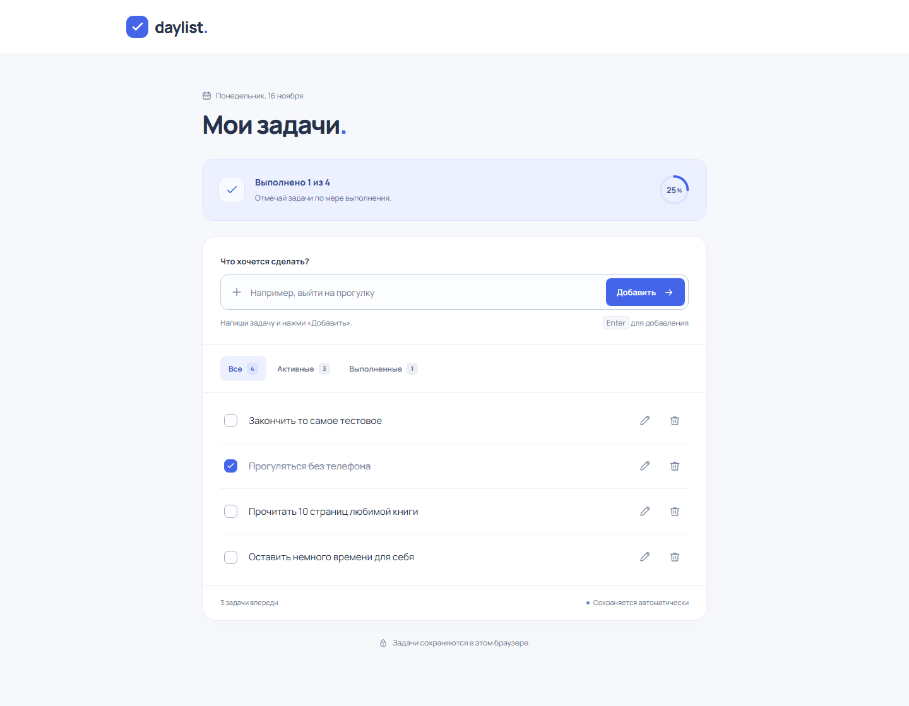

# Daylist

Небольшой список задач с дружелюбным светлым интерфейсом. Тестовое задание
на позицию вайбкодера, выполненное с помощью AI.

[Открыть сайт](https://skkkystyle.github.io/daylist/)



## Возможности

- Добавление кнопкой или через Enter; пустой ввод не принимается.
- Отметка выполнения и возврат в активные.
- Удаление с отменой последнего удаления.
- Сохранение задач и их состояния после обновления страницы.
- Фильтры «Все / Активные / Выполненные», счётчик и индикатор прогресса.
- Адаптация под телефон, управление с клавиатуры, поддержка reduced motion.
- Сообщения о повреждённых данных или ошибках сохранения.

При первом открытии список пустой. Кнопки с примерами добавляют задачи только
по нажатию пользователя.

## Запуск

Понадобятся Node.js 22.12+ (рекомендуется 24 LTS) и npm.

```bash
npm ci
npm run dev
```

Сборка и просмотр production-версии:

```bash
npm run build
npm run preview
```

## Проверки

```bash
npx playwright install chromium
npm test
```

На Linux могут понадобиться системные зависимости браузера:
`npx playwright install --with-deps chromium`.

Playwright проверяет добавление, переключение выполнения, фильтрацию, удаление,
отмену удаления, перезагрузку, длинные строки, безопасный вывод пользовательского
текста, повреждённые данные и блокировку localStorage. Сценарии выполняются для
desktop и мобильного viewport. Отдельный тест снимает три состояния интерфейса;
результаты лежат в `tests/screenshots/output/` и не коммитятся.

`npm run build` также запускает проверку типов TypeScript. Сборка и браузерные
проверки выполняются локально перед публикацией.

## Публикация

Исходники находятся в ветке `main`, готовая сборка — в `gh-pages`.
GitHub Pages публикует корень ветки `gh-pages`. Для обновления сайта нужно
проверить проект, выполнить `npm run build` и загрузить содержимое `dist/`
в эту ветку. Пустой файл `.nojekyll` отключает обработку сборки через Jekyll.

Относительные пути в конфигурации Vite позволяют разместить сайт в подпапке
GitHub Pages. Файлов workflow в проекте нет: публикация использует штатную
сборку Pages из ветки.

## Стек и архитектура

React, TypeScript, Vite и обычный CSS. Шрифт Manrope поставляется с приложением
через Fontsource, без запросов к Google Fonts.

```text
src/
├── components/      # форма, фильтры, список, задача и SVG-иконки
├── hooks/useTasks.ts # состояние задач, действия и отмена удаления
├── lib/storage.ts   # чтение, валидация и запись localStorage
├── types.ts         # Task и TaskFilter
├── App.tsx          # сборка интерфейса, фильтр и вычисляемые счётчики
├── styles.css
└── main.tsx
```

Состояние хранится во встроенных хуках React. Сервер, база данных, роутер
и отдельный менеджер состояния для этого объёма не требуются. Задача содержит
`id`, `title` и `completed`; после изменения список сохраняется целиком.

Решения и исходные требования записаны в [брифе проекта](PROJECT_BRIEF.md),
визуальные решения — в [DESIGN.md](DESIGN.md).

## Хранение данных

Задачи хранятся под ключом `daylist.tasks.v1` в localStorage текущего адреса сайта.
Они не передаются на сервер и не синхронизируются между устройствами или вкладками.
Очистка данных сайта удаляет список. В приватном режиме данные обычно удаляются
после закрытия приватной сессии.

Если сохранённые данные повреждены, приложение показывает предупреждение и
не перезаписывает их при открытии. Первое изменение нового списка заменяет
повреждённые данные. Если запись недоступна, список продолжает работать в памяти,
но изменения могут пропасть после перезагрузки.

Отмена возвращает только последнюю удалённую задачу, включая её позицию и статус.
Возможность отмены доступна до закрытия уведомления или обновления страницы.

## Использование AI

Использован **OpenAI Codex** для обсуждения требований и архитектуры, написания
React/TypeScript/CSS, подготовки тестов, поиска ошибок и настройки публикации.

Для визуальных решений использован открытый навык
[UI UX Pro Max](https://github.com/nextlevelbuilder/ui-ux-pro-max-skill): рекомендации
по типографике, взаимодействию, адаптивности и доступности. Палитра и композиция
адаптированы к согласованному брифу. Навык — набор инструкций, отдельная AI-модель
для него не использовалась.

Результат проверен автоматическими сценариями в браузере и просмотром скриншотов
desktop и мобильной версии.
